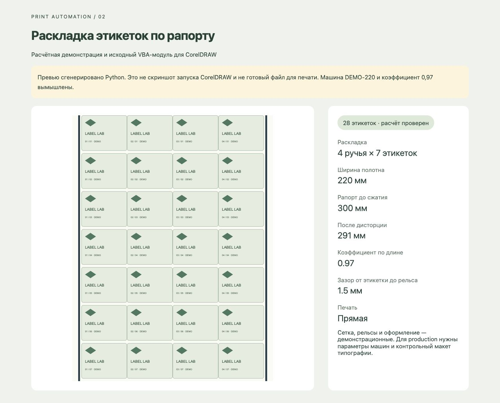

# Раскладка этикеток для CorelDRAW

Самостоятельный тестовый пример: исходный **VBA-модуль** раскладки сгруппированной этикетки по ручьям и рапорту, дисторция всей композиции по длине и демонстрационные боковые рельсы. Есть переносимый расчётный модуль Python и SVG-превью.



**Запуск VBA в CorelDRAW 2020/2026 не проверялся. Скомпилированный `.gms` не поставляется. Python-тесты подтверждают только расчёт и SVG, а не работу объектной модели CorelDRAW или готовность к печати.**

## Быстро посмотреть без CorelDRAW

Python 3.9+, внешних зависимостей нет:

```sh
python3 -m unittest -v
python3 planner.py
python3 -m http.server 8782 --bind 127.0.0.1
```

Откройте http://127.0.0.1:8782/examples/preview.html. Готовые [SVG](examples/layout.svg) и [координаты JSON](examples/layout.json) также включены в репозиторий. Для зеркального варианта: `python3 planner.py --reverse --out examples-reverse`.

## VBA в CorelDRAW Windows

1. Откройте **копию** документа с этикеткой. Для теста можно импортировать `examples/source-label.svg`, проверить размер 50 × 40 мм и сгруппировать все его элементы. Этикетка должна быть одной выбранной группой, соответствующей реальному габариту.
2. В редакторе VBA создайте собственный macro project и импортируйте `LabelImposition.bas` (File → Import File). При необходимости включите VBA-компонент в официальном установщике CorelDRAW. Используйте стандартную проверку макроса перед запуском; не отключайте глобальную безопасность.
3. Выполните Debug → Compile и `TestLayoutMath`. Зафиксируйте версию CorelDRAW и результат.
4. Выполните `BuildDemoRapport`. Введите ширину полотна, рапорт, коэффициент, ручьи, этикетки по вертикали и режим печати. Демонстрация использует последовательные InputBox; полноценная UserForm со списками машин/рапортов ещё не реализована.
5. Результат создаётся на **новой странице того же документа**. Исходная группа не масштабируется. Проверьте визуально, затем сохраните проект макроса как `.gms` средствами CorelDRAW. При сбое частичный результат объединён в группу отмены; используйте Undo и вернитесь к сохранённой копии.
6. Перед экспортом PDF/CDR согласуйте bleed, цветоделение, шрифты, прозрачности, профиль PDF и геометрию меток с типографией. Автоматического production-экспорта в этом примере нет.

## Демонстрационные параметры

DEMO-220 — вымышленная машина: полотно 220 мм, рапорт 300 мм, коэффициент 0,97, ширина рельса 2 мм, зазор от этикетки до рельса 1,5 мм. Этикетка в превью 50 × 40 мм. Получаем 4 ручья × 7 этикеток = 28 штук; длина после сжатия 291 мм.

Расчёт: `maxColumns = floor((web - 2*(clearance + railWidth))/labelWidth)`, `maxRows = floor(rapport/labelHeight)`. Сетка центрируется по ширине. Вертикальный шаг равен `rapport/rows`; остаток по длине распределён между повторениями. После раскладки применяется коэффициент к **всей композиции**, включая рельсы. В демо обратная печать трактуется как зеркало по X; типография должна подтвердить направление.

## Что нужно уточнить для полного решения

- Перечень печатных машин, ширина полотна и допустимые рапорты каждой машины.
- Таблица дисторции и определение коэффициента: множитель или процент сжатия; область применения к меткам.
- Геометрия и положение «лыж»/рельсов, допустимые поля, bleed и межэтикеточные зазоры.
- Контрольный исходный CDR и эталонный результат, правила нескольких этикеток/страниц.
- Требуемые экспортные форматы/профили, версия CorelDRAW 2020/2026 для приёмки.

Это демонстрация ядра раскладки, а не полная реализация чужого ТЗ. Исходное ТЗ и файлы заказчика не распространяются; все рисунки и параметры в примере вымышлены.

## Проверка

8 Python-тестов проверяют число этикеток, координаты, симметрию и зазоры рельсов, сжатие координат/высот, границы полотна, ошибки входных данных, зеркальное SVG и точное заполнение. `TestLayoutMath` в VBA доступен для последующего запуска внутри CorelDRAW. Статус native compile/run: **не выполнялся**, нужен Windows с CorelDRAW и VBA.

## Источники API

- [Document.AddPages, CorelDRAW 2020.1](https://community.coreldraw.com/sdk/api/draw/22.1/m/document.addpages)
- [Shape.MoveToLayer, CorelDRAW 2026](https://community.coreldraw.com/sdk/api/draw/27/m/shape.movetolayer)
- [Shape.Flip](https://community.coreldraw.com/sdk/api/draw/24.1/m/shape.flip?lang=cli)
- [Layer.CreateRectangle2](https://community.coreldraw.com/sdk/api/draw/25/m/layer.createrectangle2?lang=vb)

Методы сверены с документацией 26 октября 2026. Совместимость полного VBA-модуля требует компиляции и визуальной проверки в целевых версиях.
